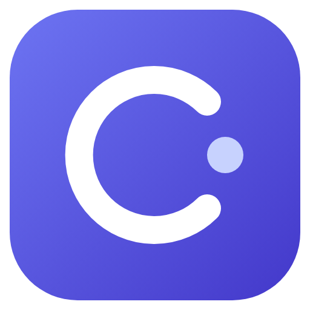
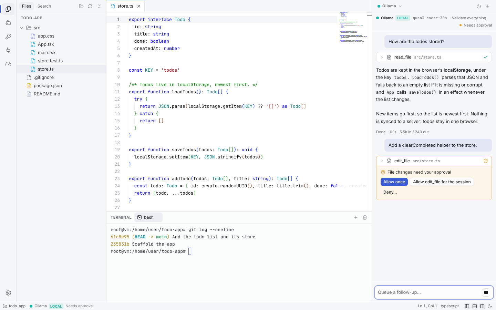
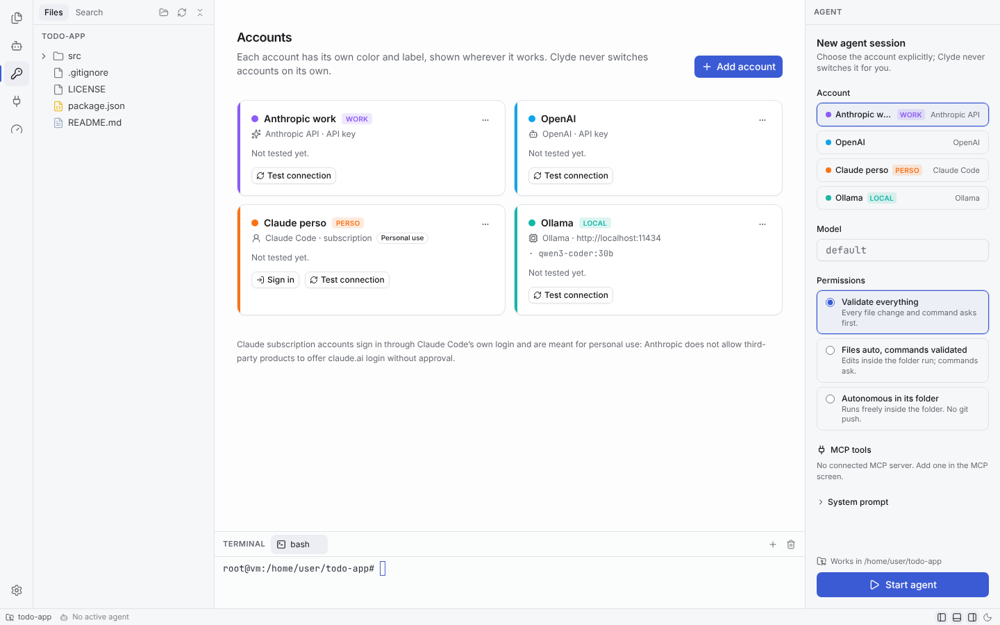
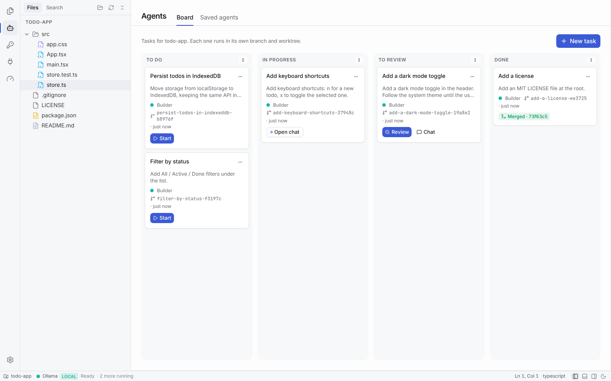
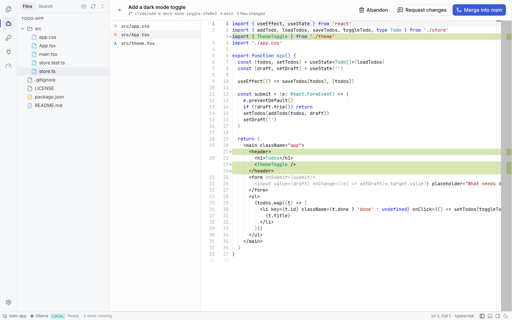
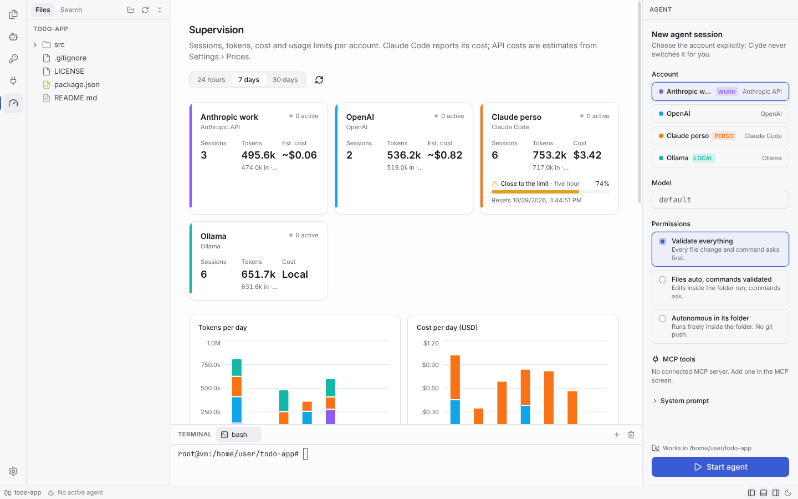
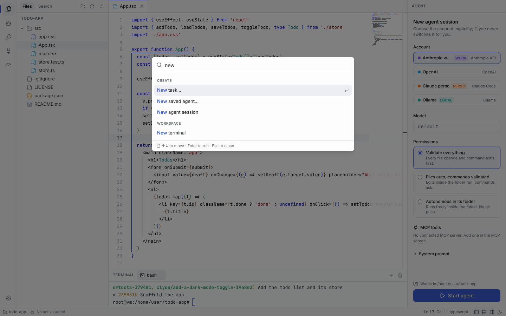
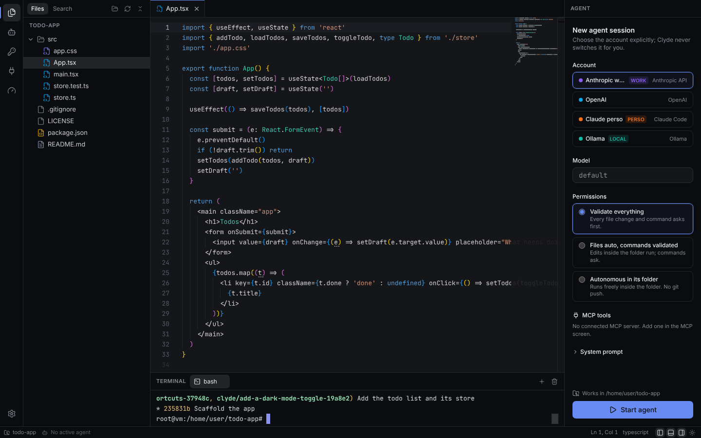

<p align="center"></p>

<h1 align="center">Clyde</h1>

<p align="center">Agent-centric desktop IDE for Windows: several AI accounts and providers side by side, several agents on one repository, live supervision, and MCP tools allowed per agent.</p>



## Download

Get **Clyde-Setup-&lt;version&gt;.exe** from the [releases page](https://github.com/ferreroantoine/clyde/releases) and run it. It installs for your user without admin rights, adds Start menu and desktop shortcuts, and starts Clyde. The installer is not code-signed yet: if SmartScreen says "Windows protected your PC", click **More info**, then **Run anyway**.

No install wanted? Take **Clyde-&lt;version&gt;-portable.exe** from the same page: one file that runs from any folder or a USB stick and keeps its data in `Clyde-data` next to it. It unpacks itself (about 600 MB) at each start, so it is slow to open: 37 seconds on GitHub's Windows test machine, against a few seconds for the installed version. API keys are encrypted for your Windows account, so on another computer you enter them again.

Then open a folder and add an account in **Accounts**. The task board also needs [Git for Windows](https://git-scm.com/download/win).

## Tour

**Accounts.** Claude, ChatGPT and Gemini subscriptions (through Claude Code's, Codex's and Antigravity's own sign-in), Anthropic, OpenAI and Gemini API keys, and local Ollama models, each with a color and a label that follow it everywhere. Clyde never switches accounts for you.



**Task board.** Each task runs a saved agent in its own branch and git worktree, so several agents can work on one repository at once.



**Review.** Read the diff of a task, then merge it, request changes (the agent picks up your comments in the same worktree) or abandon it.



**Chat, dictation, memory.** Plain conversations next to the agents, local voice dictation, and one memory shared by every agent, with what each session costs in context.

**Supervision.** Sessions, tokens, cost and usage limits per account, charts per day, and the full transcript of every session.



**Command palette** (`Ctrl+K`) for every action, and `Ctrl+P` to open a file. Light and dark themes follow the system or your choice.





## Stack

Electron 45, React 19, TypeScript (strict), electron-vite, Tailwind CSS v4 + shadcn/ui, Monaco, xterm.js + node-pty, SQLite (better-sqlite3).

Docs: [original spec](docs/SPEC.md) (French), [approved plan](docs/PLAN.md), [iteration 2 plan](docs/PLAN-ITERATION-2.md) (French).

## Status

| Phase | Content | State |
| --- | --- | --- |
| 1 | Electron skeleton, layout, themes, explorer, Monaco, terminal, SQLite | done |
| 2 | Account profiles, encrypted secrets, Claude Code provider, agent chat, permissions | done |
| 3 | API providers (Anthropic, OpenAI, Mistral, Ollama), in-house agent loop, MCP | done |
| 4 | Parallel agents, git worktrees, Kanban, diff review and merge | done |
| 5 | Supervision dashboard, metrics, command palette, polish, packaging | done |

Iteration 2 (see its plan): providers, usage limits, settings, animations, chat, dictation, MCP catalog, memory and context: done.

## Build from source on Windows

### Prerequisites

- **Node.js 22.12 or later** (developed on Node 24) and npm
- **Git for Windows**
- **C++ build tools**, only needed for a plain `npm install`:
  - Visual Studio 2022 Build Tools with the *Desktop development with C++* workload and the *MSVC Spectre-mitigated libs* component
  - Python 3

  From an elevated PowerShell:

  ```powershell
  winget install Microsoft.VisualStudio.2022.BuildTools --override "--wait --passive --add Microsoft.VisualStudio.Workload.VCTools --includeRecommended --add Microsoft.VisualStudio.Component.VC.Runtimes.x86.x64.Spectre"
  winget install Python.Python.3.12
  ```

Why the build tools: `node-pty` and `better-sqlite3` ship N-API prebuilt binaries for Windows x64/arm64 that load in Electron without recompiling. But npm still runs `node-gyp rebuild` for `better-sqlite3` during install, and that step needs a compiler and Python. If you cannot install them, use the prebuilt-only install below. The app uses the prebuilt binaries either way.

### Install and run

```powershell
git clone <repo> clyde
cd clyde
npm install            # or, without build tools: npm run install:prebuilt
npm run dev
```

Both install commands end by downloading the Electron binary (`install-electron`), which electron-vite needs before `npm run dev`.

### Scripts

| Script | What it does |
| --- | --- |
| `npm run dev` | Starts the app with hot reload |
| `npm run build` | Builds main, preload and renderer into `out/` |
| `npm run preview` | Runs the built app |
| `npm run typecheck` | TypeScript, strict, for both main and renderer |
| `npm run lint` | ESLint |
| `npm test` | Vitest unit tests |
| `npm run package` | Builds the Windows installer (NSIS) into `release/`. Run it on Windows |
| `npm run package:dir` | Builds an unpacked app into `release/`, to check a package without installing it |
| `npm run install:prebuilt` | `npm install --ignore-scripts` then `install-electron`, for machines without C++ build tools |
| `npm run drive -- <outDir> '<steps json>'` | Launches the built app with Playwright, runs steps and takes screenshots (see `scripts/drive.mjs`) |
| `npm run smoke:packaged -- <exe>` | Checks a packaged app: database, terminal, search, Claude Code binary |

## Using it

- **Chat** (first icon, the start view by default): plain conversations, apart from the agent panel. Pick a saved agent, or an account and a model; the button takes the account's color. Conversations are grouped by date, searchable (titles and messages), and can be renamed, pinned and deleted. Answers render Markdown (tables, task lists, code with the editor's colors and a copy button, math with KaTeX) and stream in. Each message can be copied; your messages can be edited and sent again, and the last answer regenerated (both replace what followed). Attach text files and images with the paperclip, by pasting, or by dropping files from the system or the Explorer. The chat only reads: it never writes files or runs commands; a switch lets the model use the MCP tools allowed for the chosen agent. *Continue in the project* opens an agent session in the open folder with the conversation as context, without spending a turn. Each conversation shows what it used (plan points for subscriptions, cost for API accounts). Conversations live in the app database; attachments in `userData/chat`.
- **Dictation**: a microphone button in the chat, the agent panel and the new-task dialog, and a shortcut (`Ctrl+Alt+D` by default; click to start and stop, or hold to talk, in Settings › Voice). The transcript goes where the cursor is and is never sent on its own. By default it runs locally with [whisper.cpp](https://github.com/ggml-org/whisper.cpp): Settings › Voice downloads `whisper-cli` (Windows x64 and Linux x64, CPU build of release b5454, checked by SHA-256) and the model of your choice (tiny 78 MB to large-v3-turbo 1.6 GB, from Hugging Face, checked too), so the audio never leaves the machine. On macOS, install it with `brew install whisper-cpp`; for GPU (Vulkan or CUDA), point Settings › Voice to your own build. An OpenAI or Gemini account can transcribe instead (the audio is then sent to that provider). Hesitations ("euh", "hum"…) are removed by simple rules from an editable list; an optional pass through a light model (an Ollama account by default) rewrites the punctuation and false starts.
- **Open a folder**: the button in the explorer or `Ctrl+O`. Clyde reopens the last workspace at startup (Settings › General can turn that off and set the folder the picker starts in).
- **Command palette**: `Ctrl+K` (or `Ctrl+Shift+P`) for every action, with the workspace files as you type; `Ctrl+P` goes straight to files.
- **Keyboard**: `Ctrl+B` sidebar, `Ctrl+J` or `` Ctrl+` `` terminal, `Ctrl+Alt+B` agent panel, `Ctrl+Shift+E` files, `Ctrl+Shift+F` search, `Ctrl+S` save, `Ctrl+,` settings.
- **Terminal**: pwsh when installed, otherwise Windows PowerShell; another shell (PowerShell 7, Windows PowerShell, Command Prompt, Git Bash, WSL or any program) can be set in Settings › Terminal. `Ctrl+C` copies when text is selected (otherwise it interrupts) and `Ctrl+V` pastes, as in Windows Terminal.
- **Editor**: if a file changes on disk while you have unsaved edits, a banner lets you load the disk version or keep yours.
- **Accounts** (Settings › Accounts & providers): each account has a name, a short label and a color. Accounts are grouped by vendor, each with a CLI that runs on your subscription and an API:

  | Vendor | Subscription (CLI) | API key (Clyde's agent loop) |
  | --- | --- | --- |
  | Claude | Claude Code, signed in with `claude auth login` (or Claude Code with a Console key) | Anthropic API |
  | ChatGPT | Codex CLI, signed in with `codex login` | OpenAI API |
  | Gemini | Antigravity CLI (`agy`), signed in on its first start | Gemini API (AI Studio key) |
  | Local | | Ollama (server URL, `http://localhost:11434` by default) |

  - Signing in opens the CLI's own login in an embedded terminal; the browser does the rest and Clyde never sees the credentials.
  - **Test connection** checks the sign-in or the key and lists the models, without sending a prompt.
  - The page shows which CLIs Clyde found and their versions. Claude Code ships with Clyde; install Codex with `npm install -g @openai/codex` and Antigravity from [antigravity.google](https://antigravity.google), or set their paths in Settings.
  - Antigravity keeps its sign-in in the Windows credential store, once per Windows user, so Clyde allows one Antigravity account.
  - Mistral is no longer supported. Updating removes Mistral accounts and the saved agents that used them, says so once, and keeps their past sessions in the history.
- **MCP servers** (Settings › MCP): add local commands (stdio) or remote URLs (streamable HTTP, with a fallback to SSE), or import the `mcpServers` of `claude_desktop_config.json`. Each server shows its status, its error if any, and its tools. Environment variables and headers are encrypted like API keys and never shown again. A **catalog** lists checked servers, off until you add them: Filesystem (the open project by default), Git, Fetch, GitHub (hosted server, with a token), Playwright, Context7 and Docker (community server). Each card shows its publisher, tools, the parameters it asks for, what it needs installed (Node.js for `npx`, [uv](https://astral.sh/uv) for `uvx`) and its context cost (number of tools and estimated tokens of their definitions). *Test* starts it without saving and lists its tools. Adding a server gives it to no agent: you still tick its tools per agent, and the tool picker warns when an agent carries a lot of tool definitions. Your own servers can be saved as presets (their secrets are asked again at install). SQLite is not offered: its reference server is archived.
- **Agents** (right panel): pick an account, an optional model, a permission level, the MCP tools the agent may use (none by default) and an optional system prompt, then chat. API agents get five built-in tools: `read_file`, `write_file`, `edit_file`, `list_files` and `run_command` (PowerShell on Windows, bash elsewhere). Tool calls appear as collapsible cards; anything that needs your approval shows inline with *Allow once*, *Allow for the session* (the exact command, for shell tools) and *Deny*, where you can tell the agent what to do instead. Up to 4 agents run at once by default (Settings › Agents). Each agent's shell commands also appear, read-only, in a terminal tab named after its account (live output for API agents; Claude Code reports output when the command ends).
- **Agents screen** (robot icon):
  - *Saved agents*: an account, a model, a permission level, MCP tools and a system prompt. *Chat in this folder* starts one in the agent panel.
  - *Board*: To do → In progress → To review → Done, for the open git repository. Cards can be dragged: within a column to reorder them, from *To do* to *In progress* to start a task, and from *To review* to *Done* to merge it; the other cards slide aside to show where it lands. Creating a task makes a branch `clyde/<slug>` and a git worktree outside the repository (`%LOCALAPPDATA%\Clyde\worktrees`), from the branch checked out at that moment. *Start* runs the task's agent there, with the task as its first message; when it finishes its turn the task moves to *To review*.
  - *Review*: the changed files (the agent's commits plus what it left uncommitted) and a side-by-side diff. *Merge* commits what is left and merges with `--no-ff` into the branch the task started from, in your main folder; on a conflict the merge is undone and the files are listed. *Request changes* sends your comments to the agent in the same worktree. *Abandon* deletes the worktree and the branch.
- **Usage limits** of subscription accounts: a 5-hour and a weekly gauge per account (plus per-model limits when the CLI reports them), with the countdown and date of the reset; mini gauges of the active agent's account in the status bar; each session's share in points, in the agent panel, on board cards and in the history; a 7-day chart in Supervision; alerts at 75 and 90 % (5-hour) and 85 and 95 % (weekly), as a toast and a desktop notification. Every value is marked *Official* (reported by the CLI), *Estimated* (computed by Clyde, when several sessions shared an account and the growth was split by tokens) or *Unavailable*. Sources: Claude Code's structured `/usage` after each turn and a status line bridge installed in each Claude profile (an existing status line is chained, not replaced); Codex's `account/rateLimits/read`; Antigravity reports nothing Clyde can read yet (the *Diagnostic* button shows what `agy -p /usage` answers). Accounts with no running agent are read every 10 minutes, without sending a prompt. API accounts keep a cost instead.
- **Supervision** (gauge icon): per account, active sessions, sessions, tokens, cost and the latest usage limit Claude Code reported; tokens and cost per day; the history of sessions, each with its transcript. Claude Code's cost is the one it reports; API costs are estimates from **Settings › Prices**, which ships with the Anthropic, OpenAI and Gemini list prices (October 2026) and lets you add the models you use. Ollama counts as free, and so do Codex and Antigravity turns, which run on a subscription.
- **Memory & context** (Settings › Memory & context): one memory shared by every agent, in two parts. *About you* (`userData/memory`) reaches each CLI account's own global file (`CLAUDE.md` in the Claude profile, `AGENTS.md` in the Codex home, `.gemini/GEMINI.md` in the Antigravity home), never a repository. *This project* (`<repo>/.clyde/memory`) is copied into the project's `CLAUDE.md` and `AGENTS.md`, and `GEMINI.md` when the project has one. Clyde only writes between `<!-- clyde:memory -->` markers; the rest of those files stays yours. API agents get both in their system prompt. Each part has a short core, counted against a token budget (1,500 by default) because it is sent in every session, and detailed notes that agents see by title and read only when they need them. Anything shaped like a key or token is masked before it is written. When a project session ends, the model for Clyde's own tasks proposes changes; you review them as a diff, edit, apply or dismiss them. *Consolidate* proposes a tidier core the same way.
  - Clyde's own small tasks (summaries, chat titles, memory proposals) use the first Ollama account by default, or the account chosen there, so no subscription is spent on them.
  - API sessions keep a stable prefix (instructions, memory, tools) marked for Anthropic's prompt cache, shorten tool results already read (the agent can fetch the full text with `read_tool_output`), and summarize their oldest turns past a threshold (80,000 tokens by default). The agent panel shows how full the context is; *Compact* uses Claude Code's `/compact`, Codex's `thread/compact/start` or Clyde's summary for API sessions, and *New session with summary* restarts the same agent with a summary. Antigravity only gets the second: its `/compact` is not documented.
  - Chat conversations can use relevant passages of your earlier ones (*Past conversations*, once turned on in settings), found with local embeddings from Ollama (`nomic-embed-text` by default) and stored in the app database.
  - Supervision shows each account's prompt-cache rate and where the tokens of API sessions go (instructions, memory, tool definitions, conversation, tool results, answers); the CLIs only report totals.
- **Settings** (gear icon or `Ctrl+,`): one page with a search across every setting, saved as you change them.
  - *General*: language (English or French, or the system's), start view, reopening the last project, default projects folder, and whether closing the window quits or keeps Clyde in the system tray.
  - *Appearance*: theme, accent color, density, interface text size and animations: *Full*, *Reduced* (fades only) or *Off*. The system's "reduce motion" setting always lowers *Full* to *Reduced*.
  - *Accounts & providers*, *MCP*: the account and MCP server screens, plus the paths of the Claude Code, Codex and Antigravity executables.
  - *Agents*: default permission level and model, agents running at once, worktrees folder and whether merged worktrees are deleted.
  - *Usage & limits*, *Editor*, *Terminal*, *Notifications* (desktop notifications when an agent finishes or waits for approval, sounds).
  - *Keyboard shortcuts*: every window shortcut can be rebound; conflicts, including with the editor's own keys, are shown before you keep them.
  - *Data & privacy*: export the configuration to JSON (accounts, MCP servers, saved agents, prices and settings, never a key, token or MCP secret), import it on another machine, purge the history, open the database and logs folders.
  - *About*: versions and the open-source licenses of the dependencies.
  Each section has *Reset section*. Settings are one versioned document: an older install's settings are migrated, and a newer one's are left untouched.

### Permission levels

| Level | Reads in the folder | File edits in the folder | Shell commands | Anything outside the folder |
| --- | --- | --- | --- | --- |
| Validate everything | run | ask | ask | ask |
| Files auto, commands validated | run | run | ask | ask |
| Autonomous in its folder | run | run | run, except `git push` and `cd` out of the folder | refused |

The levels apply the same way to every kind of agent: the built-in tools of API agents map onto the same rules, and Codex sends its approval requests (commands, file changes, more sandbox access) to the same engine. For Codex, the level also picks its sandbox and approval policy: *Validate everything* runs it read-only, the two others let it write in the folder.

Antigravity is the exception: in headless mode it cannot ask, so anything that would need approval is refused instead. *Validate everything* is read only, *Files auto* edits files but runs no commands, *Autonomous* runs commands in the folder with `git push` refused. Clyde writes these rules, and the agent's MCP servers, into the account's own folder before each run (`HOME` points there for `agy`), so your own `~/.gemini` settings are left alone; two Antigravity sessions of one account must therefore use the same level and MCP tools. MCP tools and tools Clyde does not know ask first, except MCP tools in autonomous mode, and an MCP tool the agent was not given is refused at every level (Claude Code does not even see it). The checks run in a `PreToolUse` hook, which Claude Code calls before its own allow rules, so allow rules in your Claude settings cannot skip them. A shell command cannot be fully sandboxed this way: in autonomous mode, a command can still write outside the folder through absolute paths or scripts. Use the other levels when that matters.

## Architecture

```
Renderer (React, sandboxed, no Node access)
   |  window.clyde.invoke / on   (allow-listed channels only)
Preload (contextBridge, no logic)
   |  ipcRenderer
Main process
   ipc/         one file per domain; every request is validated with zod
   services/    workspace, files, watcher, search (ripgrep), pty, settings, db, secrets, profiles
   agents/      AgentManager, claude-code/ (provider, runtime, message translator),
                codex/ (app-server JSON-RPC client, session, translator), antigravity/ (pty stream reader,
                session, rules), cli/ (finding the CLIs, process and pty helpers),
                api/ (chat adapters, agent loop, built-in tools)
   permissions/ engine (pure allow/ask/deny) and approval broker
   mcp/         hub (one client per server), store, claude_desktop_config importer
   agents/tasks the Kanban board; services/worktrees (simple-git) and agent-definitions
   metrics/     sessions, transcripts, usage, rate limits, prices, dashboard queries
   memory/      memory files, managed blocks in CLAUDE.md / AGENTS.md / GEMINI.md, proposals
   context/     tool-result compaction, rolling summaries, the model for Clyde's own tasks
   chat/        conversations, chat sessions, past-conversation search (embeddings)
```

- `src/shared/ipc/contract.ts` is the single definition of every channel: request schema, response type and event payloads. Main and renderer are both typed from it.
- Every response is a `{ ok, data | error }` envelope with a stable error code, so failures reach the UI as readable messages instead of generic IPC rejections.
- File access goes through `resolveInside`, which refuses any path outside the open workspace.
- Logs (`%APPDATA%\Clyde\logs\main.log`) go through a redaction pass that masks API keys and tokens.
- Data lives in `%APPDATA%\Clyde\clyde.db` (SQLite, WAL), or in `Clyde-data` next to the exe for the portable build. Migrations are append-only in `src/main/services/db/migrations.ts` and tracked with `PRAGMA user_version`.
- API keys are encrypted with Electron `safeStorage` (DPAPI on Windows) and stored as ciphertext. They are decrypted in main only when an agent starts and never cross IPC. MCP environment variables and headers are stored the same way. On Linux without a keyring, Clyde refuses to store a key rather than keep it in clear.
- Each CLI account has its own folder under `%APPDATA%\Clyde`: `claude-profiles\<id>` (used as `CLAUDE_CONFIG_DIR`), `codex-profiles\<id>` (`CODEX_HOME`) and `antigravity-profiles\<id>` (the home folder `agy` sees). Deleting the account deletes the folder. CLI processes, and the commands of API agents, get the app's environment minus every `ANTHROPIC_*`, `CLAUDE*`, `OPENAI_*`, `CODEX_*`, `GEMINI_*`, `AGY_*`, `MISTRAL_*` and Google credential variable, so an account cannot pick up another one's key or token.
- Codex runs as `codex app-server` (JSON-RPC over stdio), one process per session. Clyde finds `codex` on PATH, or uses the path set in Settings, and starts the native binary behind npm's `codex.cmd`. The agent's MCP servers are passed in the thread config, limited to its tools.
- Antigravity runs `agy -p … --output-format stream-json` once per message, resuming the conversation with `--conversation`. `agy` prints nothing when its output is not a terminal, so it runs in a pseudo-terminal. Its flags come from the documentation at antigravity.google; check them with `agy --help` if a run fails.
- API agents talk to their provider through the official SDKs (`@anthropic-ai/sdk`, and `openai` for OpenAI, Gemini's OpenAI-compatible endpoint and Ollama's `/v1`). The key and URL are always passed explicitly, and requests go through Electron's `net.fetch`, so Windows proxy settings apply.
- Settings are one versioned document (`schemaVersion`), validated with zod; a structural change comes with a migration step, and a document written by a newer build is read but never overwritten.
- Claude Code is the binary bundled with `@anthropic-ai/claude-agent-sdk`, or the path set in Settings. Sessions load your user, project and local Claude Code settings, like `claude` does.
- Every session, its transcript (without the streaming fragments), its usage per turn and the rate-limit events are stored, so the history outlives the session and the account it ran on.
- Renderer state lives in zustand stores; components stay presentational. Error boundaries around each screen show a readable error instead of a blank window.

```
src/
  shared/     IPC contract, types, settings schema, profiles and agent events, redaction (pure, tested)
  main/       entry, window, logger, ipc/, services/, agents/, permissions/, mcp/
  preload/    window.clyde bridge
  renderer/   layout/, features/ (explorer, editor, search, terminal, accounts, mcp, agent-panel, agents, supervision,
              palette, settings),
              stores/, lib/ (ipc client, monaco, terminal registry, theme, transcript reducer), components/ui (shadcn)
```

## Subscription accounts and distribution builds

You sign in to a subscription account through the CLI's own login, and the IDE never reads the credentials. The Agent SDK documentation states that third-party products may not offer claude.ai login unless Anthropic has approved them. Subscription accounts are therefore marked "Personal use", and a distribution build (`npm run build` with `CLYDE_DISTRIBUTION=1` set, `$env:CLYDE_DISTRIBUTION=1` in PowerShell) only allows API key accounts. Subscription accounts created by a personal build show as disabled there.

## Packaging

`npm run package` builds `release/Clyde-Setup-<version>.exe`, a one-click per-user NSIS installer, and `release/Clyde-<version>-portable.exe`, which runs without installing and keeps its data in `Clyde-data` next to itself (Clyde switches its data folder when electron-builder's `PORTABLE_EXECUTABLE_DIR` is set). Build it on Windows: npm installs the Claude Code binary of the machine it runs on, and that binary (about 280 MB) is most of the package. For a distribution build, set `CLYDE_DISTRIBUTION=1` first. The installer is not code-signed, so Windows SmartScreen warns on first run.

`npm run smoke:packaged -- <app executable>` launches a packaged app and checks the parts that only break once packaged: the database, the terminal, search and the bundled Claude Code binary.

`.github/workflows/release.yml` runs on every push, on a Windows runner: it builds the installer and the portable exe, installs the first silently and runs the smoke test on the installed app, then starts the portable exe and checks that its database appears next to it. To publish, bump the version in `package.json` (and update `.github/RELEASE_NOTES.md`): the first push that carries a version without a release creates the tag `v<version>` and a GitHub release with the installer. Versions with a `-` (such as `0.1.0-beta.2`) are published as prereleases. Pushing a tag `v<version>` also publishes it.


## Known limits

- Closing Clyde ends its agent sessions. Their history stays in Supervision, but a session cannot be resumed; a task that was running goes to *To review*, and *Request changes* restarts its agent in the same worktree.
- API costs are estimates at list price (cache discounts are not applied), and only for models with a price in Settings.
- The context gauge of API sessions shows tokens without a percentage: the providers' model lists do not give the context window. Claude Code and Codex report it.
- Past-conversation search needs an Ollama account with an embedding model; without one, nothing is indexed.
- Account colors are chosen for identity, not for charts: two close colors are hard to tell apart in the Supervision bars, so the legend, the tooltips and the tables carry the same numbers.
- Remote MCP servers that require an OAuth sign-in are not supported yet; servers that take a token in a header work.
- Claude's `AskUserQuestion` tool is turned off until the panel can answer it; the agent asks in plain text instead.
- Worktrees start without `node_modules` or build output; an agent that needs them installs them in its worktree.
